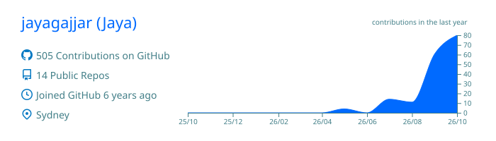
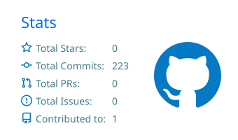
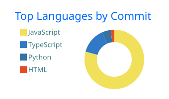
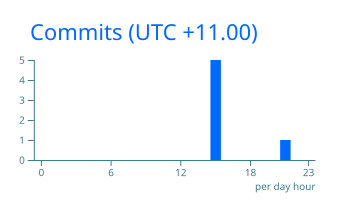

<h1 align="center">Hi, I'm Jaya 👋</h1>

  <b>Senior React & React Native developer</b> · Sydney, Australia 
  I build cross-platform apps that work for everyone, including people who don't usually get designed for.

  
  
  

---

### 🛫 What I'm building

**[FlightFriend](https://github.com/jayagajjar/flightmate)**: a mobile + web app that matches elderly travellers with flight companions, so nobody has to fly alone and anxious.

- 📱 One Expo codebase shipping to **iOS, Android and web** (React Native Web)
- 💬 Companion matching and real-time chat on **Supabase Realtime**
- 🤖 **Claude API** travel assistant and conversation icebreakers, with cost guardrails
- ♿ Accessibility first: 18pt+ type, 56px touch targets, high contrast, plain English
- 🚀 iOS app in App Store review · Google Play testing next

### 🧰 Tech I work with

                       

### 🌱 Right now

- Taking FlightFriend from beta to the public stores
- Getting deeper into **AI-assisted development** and building LLM features responsibly
- Sharing components between web and native in monorepos

### 📊 GitHub stats

  

  
  

  

---

<i>Ask me about building for elderly users, Expo, or cross-platform React. ✈️</i>

